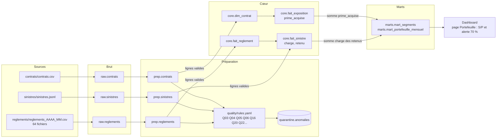

# Lignage d'un indicateur : le ratio sinistres / primes (S/P)

S/P = charge des sinistres retenus / primes acquises (définitions : `docs/contrat.md`).

## Étape par étape

| Étape | Objet | Transformation | Contrôle |
|---|---|---|---|
| 1 | Fichiers sources | Aucune | Empreinte SHA-256 dans `meta.ingestion_log` |
| 2 | `raw.*` | Copie fidèle en texte, colonnes alignées par nom (`montant_eur` -> `montant`) | Lignes lues = lignes chargées + rejetées |
| 3 | `prep.*` | Typage (dates, montants), normalisation des libellés | Lignes raw = lignes prep (test) |
| 4 | Règles qualité | Primes ≤ 0 (Q03), résiliation ≤ effet (Q04), déclaration avant survenance (Q05), hors couverture (Q06), contrat exclu (Q16), paiement en double (Q20), sinistre exclu (Q22) | Chaque ligne est en cœur ou en quarantaine (test) |
| 5 | `core.fait_exposition` | Découpage contrat × année ; exposition = jours couverts / 365,25 ; prime acquise = prime annuelle × exposition | Exposition > 0 et ≤ 366/365,25 ; somme = durée totale des contrats (tests) |
| 6 | `core.fait_sinistre` | Montant payé = somme des règlements valides ; réserve restante pour les sinistres ouverts ; charge = payé + réserve ; retenu = hors sans suite et rejeté | Montants brut = cœur + quarantaine (test) |
| 7 | Marts | Agrégation séparée des primes (par période couverte) et de la charge (par année de survenance), puis jointure au grain cible | Somme des marts = somme du cœur |
| 8 | Dashboard | Lecture seule des marts ; alerte orange au-dessus de 70 %, rouge au-dessus de 100 % | Chiffres identiques au dossier |
